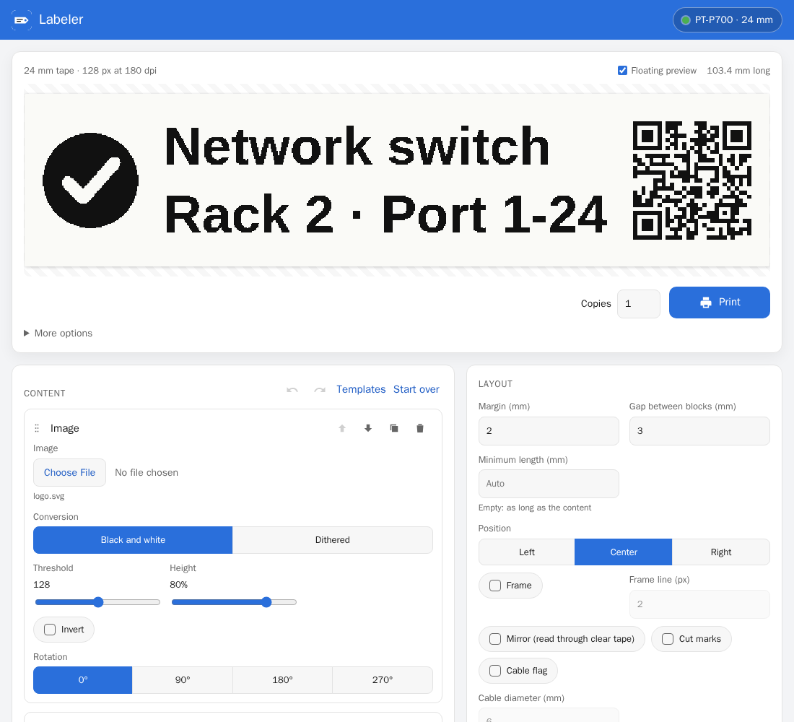
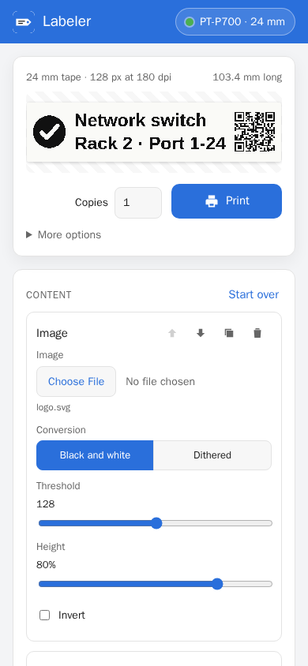
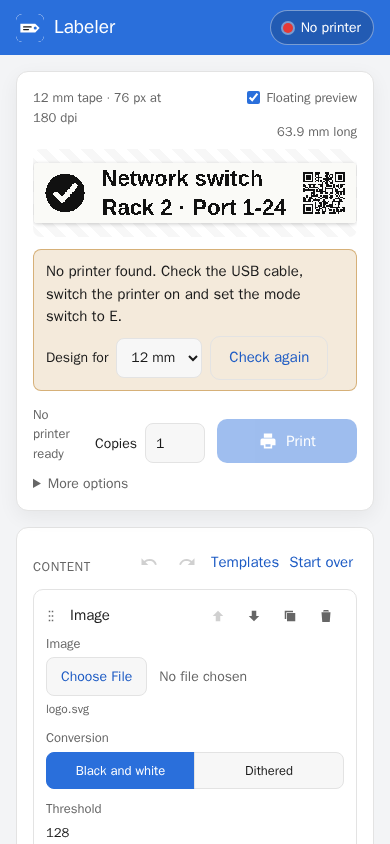
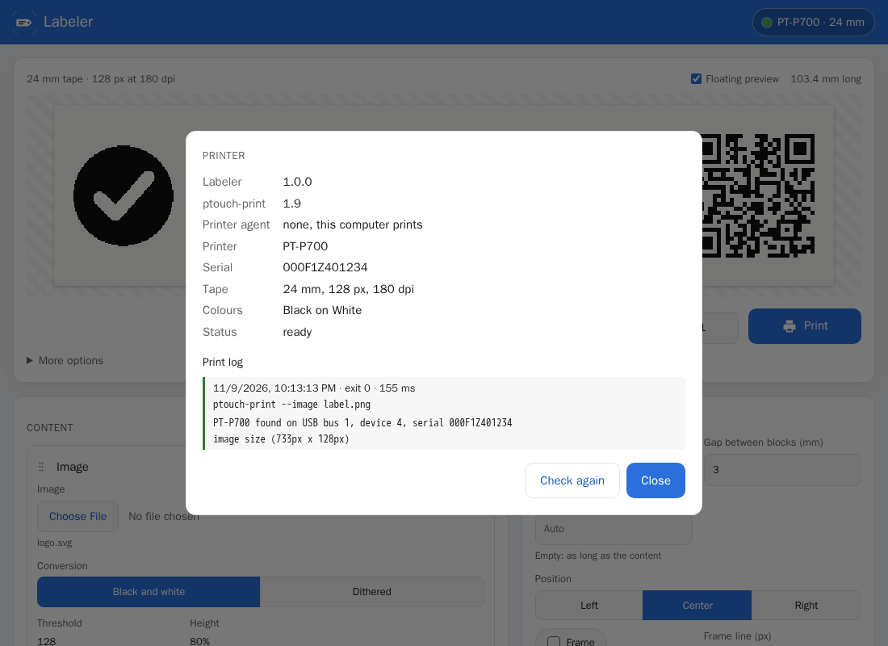

# Labeler

Design and print labels on a Brother P-Touch printer from any browser on your network: text in
any font, thousands of icons, QR codes, barcodes and images, with a live preview that shows exactly what the printer
will print.

[](https://github.com/PhilippMundhenk/labeler/actions/workflows/ci.yml)
[](LICENSE)



Labeler is a small web front end for [ptouch-print](https://git.familie-radermacher.ch/linux/ptouch-print.git)
by Dominic Radermacher, which does the actual talking to the printer over USB. It is made for a
Raspberry Pi Zero next to the printer: a few PHP files and static pages, no database, no build
step, no Docker. The label is drawn in your browser, so the Pi only passes it on.

> Labeler is an independent open-source project. It has no relation to Brother Industries and is
> neither endorsed nor supported by them. "Brother" and "P-Touch" only say which printers it
> works with.

**Works with:** the P-Touch printers ptouch-print supports (`ptouch-print --list-supported`), for
example PT-P700, PT-P750W, PT-H500, PT-D600, PT-P300BT and PT-P900W, with ptouch-print 1.5 or
newer. Tape from 3.5 to 36 mm, 180 and 360 dpi.

## Features

- **Live preview** at the printer's resolution, in the colours of the inserted tape.
- **Blocks** side by side on one label: text, icon, QR code, Code 128 barcode, image, space.
  Move, duplicate and remove them.
- **Icons** with search: about 7,400 [Material Design Icons](https://pictogrammers.com/library/mdi/)
  and 3,500 brand logos from [Simple Icons](https://simpleicons.org/), loaded on demand from the
  [Iconify API](https://iconify.design/); the chosen icon is stored in the label.
- **Text**: one to several lines, any font (built-in list, fonts you put on the Pi, or the fonts of
  your computer in Chrome and Edge), automatic or fixed size, bold, italic, alignment, white on
  black.
- **QR codes** with selectable error correction, **barcodes** with or without text below.
- **Images** (PNG, JPEG, SVG): black and white or dithered, adjustable threshold, invert.
- **Layout**: margins, gap, minimum length with position, frame.
- **Printing**: copies, chain printing and cut before the label where the installed ptouch-print
  supports them; download the label as PNG.
- **Printer status** with tape width and colour, clear messages for a missing printer, missing
  tape, P-Lite mode or missing USB permissions, and a log of the last print jobs.
- **Saved labels** in the browser; the current label is kept between visits.
- Light and dark mode, works on phones, can be added to the home screen.

## Quick start on a Raspberry Pi

1. Install PHP (`sudo apt install php-cli`) and build ptouch-print from its sources, which takes a
   few minutes even on a Pi Zero: [docs/INSTALL.md](docs/INSTALL.md#1-ptouch-print). Debian and
   Raspberry Pi OS do not package it.
2. Download `labeler-<version>.zip` from the [releases page](https://github.com/PhilippMundhenk/labeler/releases)
   and unpack it to `/opt/labeler`.
3. Allow the service to use the printer and start it:

   ```sh
   sudo useradd --system --groups lp labeler
   sudo cp /opt/labeler/deploy/99-labeler-ptouch.rules /etc/udev/rules.d/
   sudo udevadm control --reload-rules        # then unplug and plug in the printer
   sudo cp /opt/labeler/deploy/labeler.service /etc/systemd/system/
   sudo systemctl enable --now labeler
   ```

4. Open `http://<raspberry-pi>:8080/`. The badge in the top right corner shows the printer and the
   tape; click it for details and the print log.

Already running a web server with PHP? Point it at `/opt/labeler/public` instead of step 3's
service; [docs/INSTALL.md](docs/INSTALL.md) has nginx and lighttpd examples, updates and
troubleshooting.

## Configuration

Nothing needs to be configured. To change a setting, copy `config.example.php` to `config.php`, or
set the environment variable (in `labeler.service`: `Environment=`).

| Setting | Variable | Default | Purpose |
| --- | --- | --- | --- |
| `ptouch_bin` | `LABELER_PTOUCH_BIN` | `ptouch-print` | ptouch-print program, name or full path |
| `timeout` | `LABELER_TIMEOUT` | `60` | Seconds a print job may take |
| `serial` | `LABELER_SERIAL` | empty | USB serial of the printer to use when several are attached (ptouch-print 1.9) |
| `data_dir` | `LABELER_DATA_DIR` | `./data` | Writable folder for the print log; empty switches the log off |
| `fonts_dir` | `LABELER_FONTS_DIR` | `./fonts` | `.ttf`, `.otf`, `.woff`, `.woff2` files for the font list |
| `max_upload_bytes` | `LABELER_MAX_UPLOAD_BYTES` | `2000000` | Largest label image |
| `max_copies` | `LABELER_MAX_COPIES` | `50` | Most copies per print |
| `log_entries` | `LABELER_LOG_ENTRIES` | `50` | Entries kept in the print log |
| `icon_api` | `LABELER_ICON_API` | `https://api.iconify.design` | Iconify API the browser searches icons with; your own Iconify server, or empty to switch icons off |

Labeler has no login: anyone who can open the page can print. Keep it on your home network; see
[SECURITY.md](SECURITY.md).

## Screenshots

| Phone | No printer attached | Printer details and print log |
| --- | --- | --- |
|  |  |  |

Dark mode and more: [docs/screenshots.md](docs/screenshots.md).

## Documentation

- [docs/INSTALL.md](docs/INSTALL.md): installing ptouch-print and Labeler, web servers, updates,
  troubleshooting.
- [docs/DESIGN.md](docs/DESIGN.md): how it works, ptouch-print versions, and the
  [architecture decision records](docs/adr/README.md).
- [docs/DEVELOPMENT.md](docs/DEVELOPMENT.md): tests (simulated printer, browser tests, contract
  test against the real ptouch-print), coverage, releases.
- [docs/BRANDING.md](docs/BRANDING.md): name, colours and components.
- [CHANGELOG.md](CHANGELOG.md): what changed in each release.

Questions and problems: [GitHub issues](https://github.com/PhilippMundhenk/labeler/issues).

## License

[MIT](LICENSE). The bundled QR code generator (`public/lib/qrcode.mjs`) is by Kazuhiko Arase,
also MIT.
