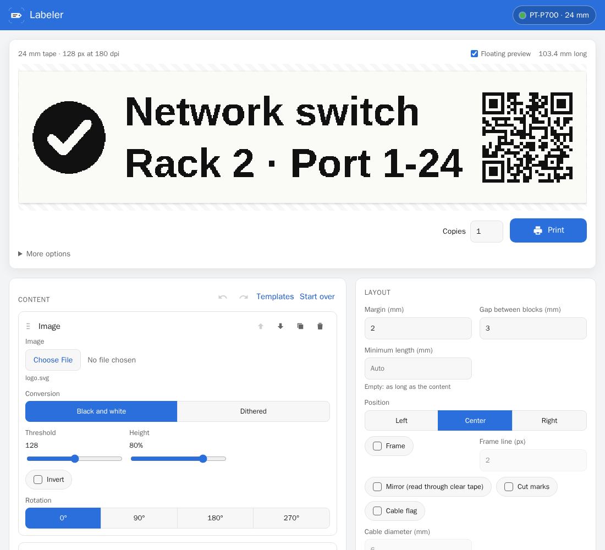
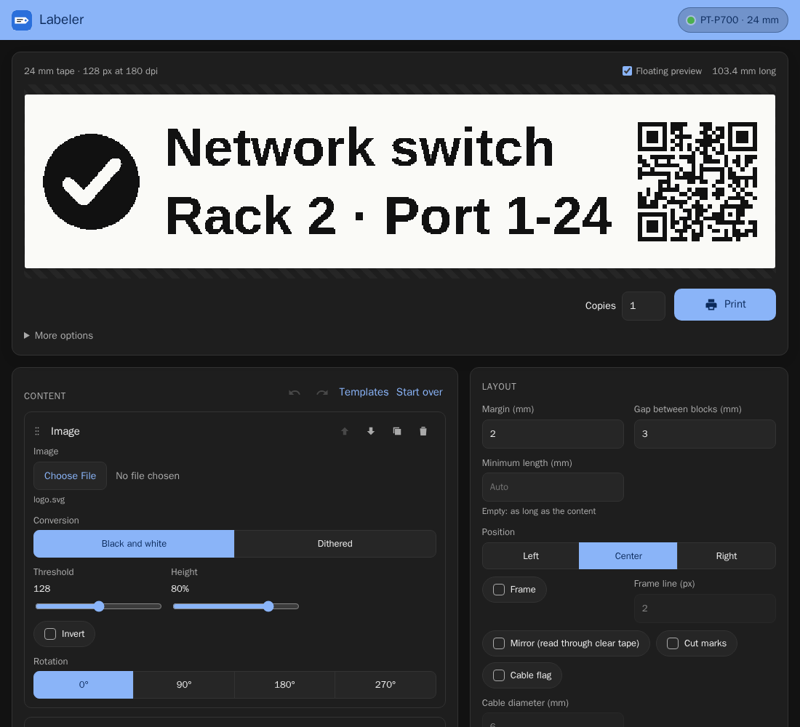
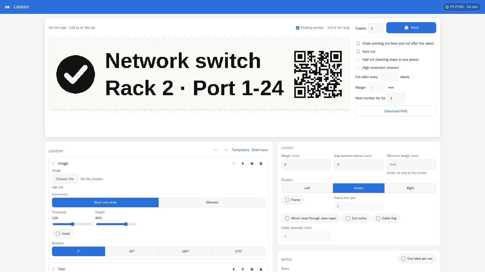
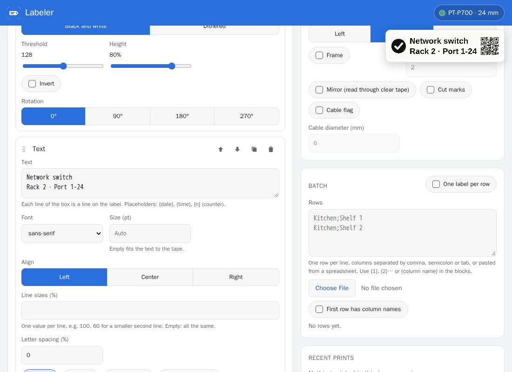
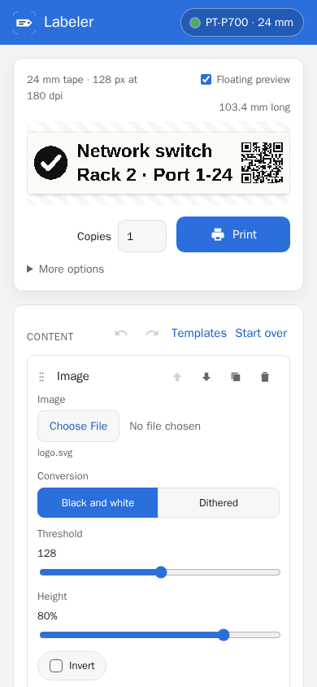
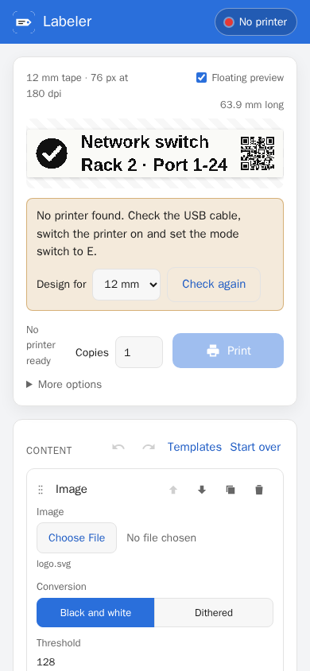
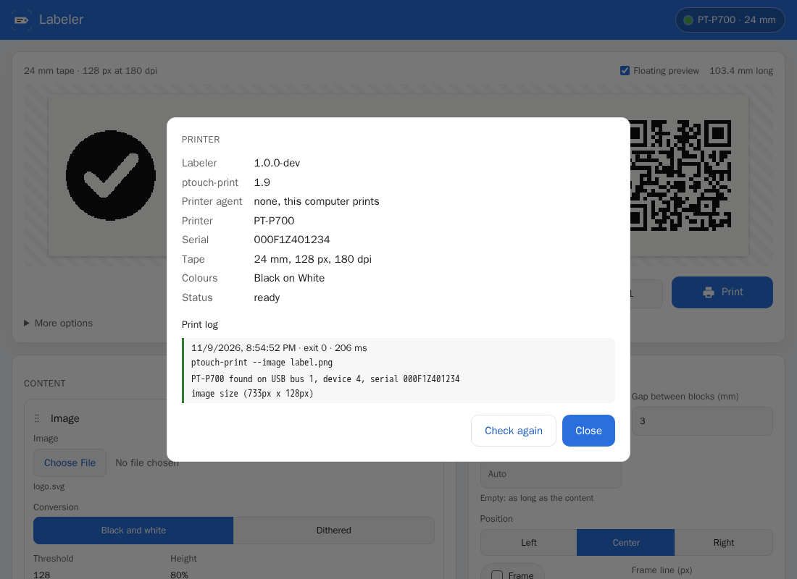

# Screenshots

All pictures come from a demo instance on the simulated printer, built by
`tools/dev.sh npm run screenshots` (`tools/screenshots.js`).

## Editor

A label with an image, two lines of text and a QR code on 24 mm tape. The preview above the editor
is the printout pixel for pixel, in the colours of the inserted tape.

| Light | Dark |
| --- | --- |
|  |  |

## Wide screen

From 1400 px wide, Print and every print option sit in a column beside the preview, always open.

## Floating preview

When the preview has scrolled out of view, a small copy of the label floats in the corner; a
click on it scrolls back. *Floating preview* next to the preview switches it off.

## Phone

| Editor | No printer attached |
| --- | --- |
|  |  |

Without a printer the tape width can be chosen to design labels in advance.

## Printer details and print log

The badge in the brand bar opens the printer details and the last print jobs with the exact
ptouch-print command and its output.

